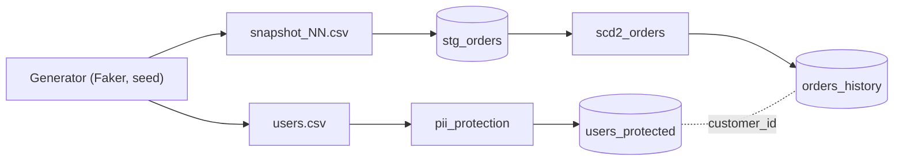

# orders-history-and-pii

Two data-engineering tasks on one shared dataset of customers and orders:

- **Order history (SCD Type 2):** hourly snapshots of current order statuses become a history table, so the status of an order is known for any moment.
- **Email protection (GDPR):** customer emails are replaced by a pseudonym for lookups and an encrypted value that can be reversed with a key.

The problem statement is inspired by a data-engineering test assignment.

The full problem statement (data, generator, requirements for both parts) is in [docs/problem-statement.md](docs/problem-statement.md).

> Status: work in progress. The generator and the infrastructure are ready, the solutions are being written.

## Data



The generator has two modes and three sizes:

| Mode | What it adds |
|:-----|:-----|
| `clean` | normal hourly snapshots, valid emails |
| `dirty` | a snapshot delivered twice, a late old snapshot, duplicated rows inside a snapshot, an order missing from one snapshot; emails with spaces and upper case, invalid and duplicated emails |

| Size | Users | Orders | Snapshots |
|:-----|:-----|:-----|:-----|
| `small` | 20 | about 40 | 6 |
| `medium` | 10 000 | about 18 000 | 24 |
| `large` | 1 000 000 | about 260 000 | 12 |

Generation time (one run on a laptop, dirty mode): `small` and `medium` take seconds, `large` about 4 minutes and 250 MB.

Besides the data, the generator writes the answers: `expected_history.csv`, `expected_users_quarantine.csv`, `traps.csv` (what was broken and where), `manifest.csv` (delivery order) and `params.json`.

## Quick start

Requires [uv](https://docs.astral.sh/uv/) (it installs Python and the dependencies from `uv.lock`) and Docker.

```bash
uv sync --all-packages
cp .env.example .env              # then set POSTGRES_PASSWORD
docker compose up -d
uv run python -m generator --size small --mode dirty
uv run python -m scripts.load snapshot data/small-dirty/snapshot_01.csv
docker compose exec db psql -U orders -d orders -c "SELECT count(*) FROM stg_orders"
```

The database listens on port 5434 by default, so it does not clash with a local PostgreSQL.

Keys for the email protection are not stored in the repository: put your own values into `PII_HMAC_KEY` and `PII_ENCRYPTION_KEY` in `.env` (names are in `.env.example`).

## Tools

| Command | What it does |
|:-----|:-----|
| `uv run python -m generator --size S --mode M --seed N` | generate a dataset into `data/S-M` (not committed) |
| `uv run python -m scripts.load snapshot FILE` | replace `stg_orders` with one snapshot |
| `uv run python -m scripts.load users-protected FILE` | replace `users_protected` with the protected CSV |
| `uv run python -m scripts.replay DIR --call "CALL ..."` | deliver all snapshots in order and run the SCD2 procedure after each |
| `uv run python -m scripts.diff_history DIR` | compare `orders_history` with `expected_history.csv` |
| `uv run pytest` | tests |

## Structure

```text
compose.yml         PostgreSQL in Docker
generator/          data generator
scripts/            loading into PostgreSQL, replay, comparison with the expected history
sql/schema.sql      tables that exist before the solutions (orders_history is created by solution.sql)
scd2_orders/        solution.sql, dbt snapshot
pii_protection/     email protection package (own pyproject.toml, code in src/)
tests/              all tests, one folder per component
docs/               problem statement, solution descriptions, decisions
```
